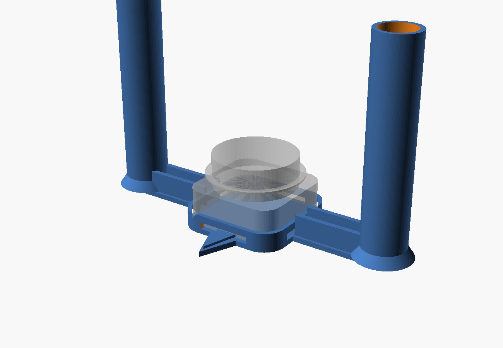

# dual_lidar_tracking

Reading two SLAMTEC RPLIDAR C1 scanners at once, drawing them live, and lining
them up with each other automatically.

The eventual goal is tracking feet on a floor grid for an interactive game, by
scanning a thin slice of air just above the floor. What's here now is the
groundwork: reliable reading, a live view, and calibration between the two
sensors. **Foot detection is not built yet.**

## Hardware

- 2 x RPLIDAR C1, over USB (they appear as `/dev/cu.usbserial-*` on macOS)
- 460800 baud, ~10 rotations/second, ~450 points per rotation (~0.8 deg apart)
- Blind zone 0.05 m, useful range 12 m

Two sensors are used because one foot can hide another. Put them at opposite
corners, at shoe height, 1-2 cm apart in height so their lasers don't confuse
each other.

## Install

```bash
pip install -r requirements.txt
```

## Live view

```bash
python3 lidar_live.py              # every lidar it can find
python3 lidar_live.py --port /dev/cu.usbserial-2130
```

Each sensor draws in its own colour. They start stacked on top of each other,
because a sensor only knows distances in its own coordinates.

| Key | |
|---|---|
| `TAB` | pick a sensor to move |
| arrows | move it |
| `<` `>` | turn it |
| `K` | **line it up automatically** |
| `V` | carpet crop: off / wedge / wedge + square |
| `B` | learn the empty carpet (stay off it) |
| `T` | follow a person |
| `S` / `L` | save / reload alignment |
| `0` | reset the picked sensor |
| `C` | save what's on screen as a CSV |
| `P` / `G` | trails / 500 mm grid |
| drag, wheel, `R` | pan, zoom, reset view |
| `ESC` | quit |

Alignment is stored in `lidar_align.json`, keyed by each sensor's serial
number, so it survives the ports swapping around.

## Lining the sensors up

### Let them see each other (`calibrate_pair.py`)

```bash
python3 calibrate_pair.py
```

The sensors are objects sitting in each other's view. If both are at the same
height, A sees B and B sees A, and that one mutual sighting gives the answer
outright: A measured the direction and distance to B, and B measured the
direction back, which is how far B is turned. Three unknowns, three
measurements, no searching and nothing to get stuck in.

First, print the jig in [hardware/](hardware/) - one per sensor - drop it over
each unit and point its arrow at the other sensor. It stands two 25 mm posts
120 mm tall, 160 mm apart, one either side of the spin axis.



It has to be posts beside the sensor rather than something on top of it,
because SLAMTEC's own numbers rule a hat out. The laser sits at 29.8 mm and the
case is 41.3 mm tall, so the beam leaves 11.5 mm *below* the top and anything
resting up there is invisible. And the scan plane is only promised level to
within 1.5 degrees, which across 3.4 m of carpet is 89 mm of drift, so a short
marker at exactly 29.8 mm can be missed entirely. Two posts also beat one:
nothing can sit on the axis, since that is where the sensor is, but the
midpoint of a pair straddling it is the axis exactly, however the jig is
turned. [hardware/README.md](hardware/README.md) has the rest.

Without a jig it falls back to single clumps, so a drinks can standing against
each sensor still works (`--no-jig`); it is just less accurate, because one
lone marker cannot sit on the axis. Either way, stand clear - a person in the
room is one more marker-shaped thing.

It reads one sensor at a time (everything being measured is standing still, so
the two scans needn't be simultaneous) and stacks about two seconds of
rotations each. Stacking matters: a single rotation puts readings 0.8° apart,
one hit every 4 cm at 3 m, so a can gets two. The sensor doesn't land on the
same angles each time round, so twenty rotations give twenty times the detail.

```
  matching on the jig's two posts: 2 for A, 1 for B, 2 pairing(s) tried
    A saw B at    37.56deg   3.270 m  (jig, posts 160 mm apart, 26 points)
    B saw A at    17.58deg   3.267 m  (jig, posts 158 mm apart, 22 points)
    the two measured the gap between them as 3.288 m and 3.284 m - 4 mm apart
    so B is at (+2.003, +2.605) m, turned -160.02deg
    the rooms then line up to 5 mm off the walls, 3533 points matched (90%)
  final: (+2.003, +2.605) m, turned -160.02deg
```

It can't tell a marker from the furniture, so it doesn't try - and it doesn't
simply trust the jig either, because a room can easily throw up two odds and
ends 160 mm apart. The jig is tried first and single clumps second, and
whatever is proposed has to survive two checks that only the right pairing
can:

- **both sides must agree on the gap.** A and B are measuring the same distance
  between the two of them, so two readings of one number that must match - a
  free check costing nothing.
- **the rooms must line up.** With the right pairing B's whole scan lands on
  A's walls; with a wrong one it lands nowhere near.

If two different pairings both pass, it says so and refuses to save rather than
pick one. That usually means something marker-shaped is still in the room.

It then hands its answer to ICP to polish, because a sighting can't win the
last couple of centimetres: a lidar measures the near *surface* of a marker and
a marker is never exactly on the spin axis. The sighting gets ICP into the
right basin; ICP squeezes out the rest against the walls. `--no-polish` shows
the raw sighting. The result goes into the same `lidar_align.json` the live
view reads, keyed by serial number, after asking first.

### Or by eye, then `K`

Nudge one roughly into place by eye, clear people out of the area, then press
`K`. It matches the shapes both sensors can see (ICP - iterative closest
point), and reports how well it did:

```
B: aligned: 7 mm off the walls, 310 points matched   (S to keep it)
```

It refuses rather than guessing when it can't be trusted:

- **poor match** - the starting guess was too far off
- **the shape here is too plain** - a bare corridor looks the same wherever you
  slide along it, so it pokes its own answer to check whether the room shape
  really pins it down
- **not enough points yet** - let the sensors spin a moment

Each point is matched to the *wall* its nearest neighbour sits on, not to that
point itself. The two sensors never sample the same spots on a wall, so
point-to-point matching drags the answer along the wall by a few centimetres.

## Cropping to the carpet

The sensors sit at opposite ends of the carpet's diagonal, so `V` cuts away
everything that isn't on it. Two filters, both worked out from where the
sensors are, so nothing has to be measured and the carpet can be any size:

- **the wedge** - each sensor only looks in a cone facing the other one, 145
  degrees by default (`--fov`). A square corner spans exactly 90 degrees, so
  anything above that is margin for catching a foot stepping off the edge.
- **the square** - two opposite corners fix a square completely, so points
  outside it are dropped. `--margin` (0.2 m by default) keeps a little of the
  floor just outside the edge.

Dropped points are still drawn, very dim, so you can see what is being cut.

This assumes the carpet is square. A rectangle isn't fixed by its diagonal
alone and would need its side length measured too.

## Following a person

`B` with the carpet empty, then `T`. It reports the point midway between your
two legs, in metres from sensor A.

It works whether the sensors are low enough to see shoes or high enough to see
shins - the logic only cares that there are one or two blobs, not what part of
a leg they are.

1. **background** - with the carpet empty, it remembers how far the nearest
   static thing is at every angle. Anything nearer than that later is a person.
2. **blobs** - the leftover points are grouped. Each blob is a leg.
3. **midpoint** - two blobs give the point between them. One wide blob is both
   legs together. One narrow blob is a single leg, and the midpoint is placed
   using the offset last measured between that leg and the middle.

**A leg in mid-stride lifts clear of the scan slice and disappears, so seeing
only one is normal while walking.** In a simulated lap that was the case on
182 of 238 readings, which is why the one-leg rule matters more than it sounds.

When nothing is visible at all it keeps moving at the last speed for 0.3 s,
then stands still for a second, then gives up and says so. It never keeps
publishing a position as though it were fresh: the state and the age of the
last real sighting are always on screen.

## Recording and plotting

```bash
python3 lidar_dump.py --seconds 10 --csv walk.csv    # record, with a text summary
python3 lidar_plot.py walk.csv                       # top-down picture
```

## Files

| | |
|---|---|
| `lidar_io.py` | opening, reading and closing a sensor |
| `align.py` | automatic alignment between sensors (ICP) |
| `calibrate_pair.py` | calibration by letting the sensors see each other |
| `hardware/` | the 3D-printable calibration jig, and how to print it |
| `area.py` | the wedge and carpet-square filters |
| `tracker.py` | background, blobs, and following a person |
| `lidar_live.py` | the live view |
| `lidar_dump.py` | record to CSV |
| `lidar_plot.py` | draw a recorded CSV |
| `tests/test_align.py` | alignment checked against known answers |
| `tests/test_calibrate_pair.py` | mutual sighting checked against a fake room |
| `tests/test_area.py` | carpet filter checked against known geometry |
| `tests/test_tracker.py` | tracking checked against a made-up walk |

## Tests

```bash
python3 tests/test_align.py
python3 tests/test_calibrate_pair.py
python3 tests/test_area.py
python3 tests/test_tracker.py
```

Builds a fake room with two sensors a known distance apart and checks the
alignment recovers it: within about a millimetre and a few hundredths of a
degree in a normal room, still working with 10 mm of noise or a 35-degree error
in the starting guess, and refusing (rather than guessing) when the guess is 90
degrees out or the room is a bare corridor.

`test_calibrate_pair.py` ray-casts an L-shaped room with a marker at each
sensor and checks the mutual sighting recovers the second sensor's place.
With the printed jig - two posts and the sensor's own case between them, all
cast properly - it comes out **4 mm** on a clean room and 14 mm with 10 mm of
noise. With a single can instead: 7 mm clean, under 5 cm noisy, dropping to a
couple of millimetres once ICP has polished it.
The room is L-shaped on purpose - a plain square has four-fold symmetry, so an
answer turned 90 degrees would overlap just as well and nothing could tell them
apart. It also checks the awkward cases: a bin left standing in the room, no
markers at all, a decoy at exactly the distance that would fool the agreement
check, and the second sensor being in another room entirely. For the jig: two
bins left standing exactly 160 mm apart, and a jig turned a quarter turn out so
one post hides behind the other - which it spots, refuses, and names the right
sensor to go and turn. The rule it holds to throughout is that a wrong answer
is never returned quietly: it is either right, or it refuses and says why.

Worth knowing from writing those tests: a far corner seen edge-on also reads as
a small isolated clump, because the wall running away from the sensor is
sampled too sparsely for its readings to join up. Finding candidates is
deliberately permissive; the agreement and overlap checks are what judge them.

`test_area.py` checks the carpet square comes out right for any size at any
angle, that the 90-degree fact holds, and that a point just off the edge is
dropped unless the margin covers it.

`test_tracker.py` walks an imaginary person past imaginary sensors: both legs
visible, one leg vanishing mid-stride, feet together, a total dropout, a bag
left on the carpet, and an impossible jump. Running the whole app against two
fake sensors with someone walking a lap, the midpoint stayed within 4 cm
(median; 10 cm at worst) of where that person actually was, never gave up while
they were walking, and reported "lost" once they left.

## Notes

The `rplidar` Python library was written for the older A1/A2, and two things it
does trip up the C1, both handled in `lidar_io.py`:

- it toggles the serial DTR line to start a "motor" every time you iterate,
  which the C1 doesn't need
- it reads one 5-byte measurement per system call, which can't keep up with
  5000 per second

Also worth knowing: the sensor takes about 2 seconds to reach full speed, so
rates measured right after connecting look low.

## Vendor material

`vendor/` holds SLAMTEC's own files, unmodified, so the protocol details stay
next to the code that relies on them:

- `vendor/docs/` - C1 datasheet and kit user manual, plus the S-series protocol
  and SDK manuals. The C1 speaks the same protocols.
- `vendor/sdk/` - the official `rplidar_sdk` (C++). Not used at runtime, but it
  is the reference for anything the Python library doesn't cover, such as the
  high-speed "dense capsule" scan mode.

SLAMTEC's SDK is BSD 2-clause; its `LICENSE` is kept with it. Not included: the
RoboStudio app (Windows only), the SDK zip (same as the extracted folder), and
the C1 3D model, all available from SLAMTEC.
