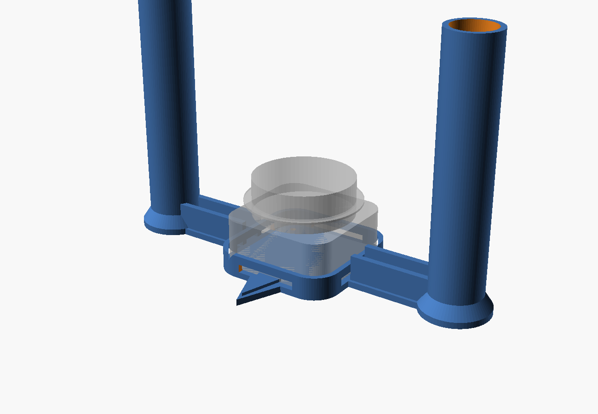

# Calibration jig for the RPLIDAR C1

Sits around a sensor and holds two posts, one on each side, so the other sensor
can see where it is. Print two, one per sensor.



| | |
|---|---|
| `calibration_target.stl` | sensor on the floor (126 mm tall) |
| `calibration_target_raised80.stl` | sensor on an 80 mm stand (206 mm tall) |
| `calibration_target.scad` | editable source |

Print **two of the same one**, so both sensors sit at the same height.

## Printing

- PLA, 0.4 nozzle, flat on the bed as the STL sits. No supports needed.
- Print both on one plate. The thin posts cool better that way.
- Bambu presets in [bambu/](bambu/). A1 times: 4h 19m (flat pair),
  8h 17m (raised pair).

## Fitting

1. Put the sensor in the jig. Optional: four **M2.5 x 5 mm** screws from
   underneath. On the raised version, reach in through the open bottom. The
   cable goes out through the side window.
2. **Point the arrow at the other sensor.**
3. Calibrate (see the main README).

If black posts don't show up in the other sensor's view, wrap them in white tape.

## Changing it

Settings are at the top of the `.scad`:

| | |
|---|---|
| `riser_h` | stand height (0 = on the floor). The posts grow with it. |
| `fit` | 0.5 mm. Raise by 0.2 if the sensor is too tight. |
| `post_offset` | 80 mm. If changed, set `JIG_SPAN_M` in `calibrate_pair.py` to `2 x post_offset` (in metres). |

```bash
openscad -o calibration_target.stl calibration_target.scad
openscad -o raised.stl -D riser_h=80 calibration_target.scad
```
