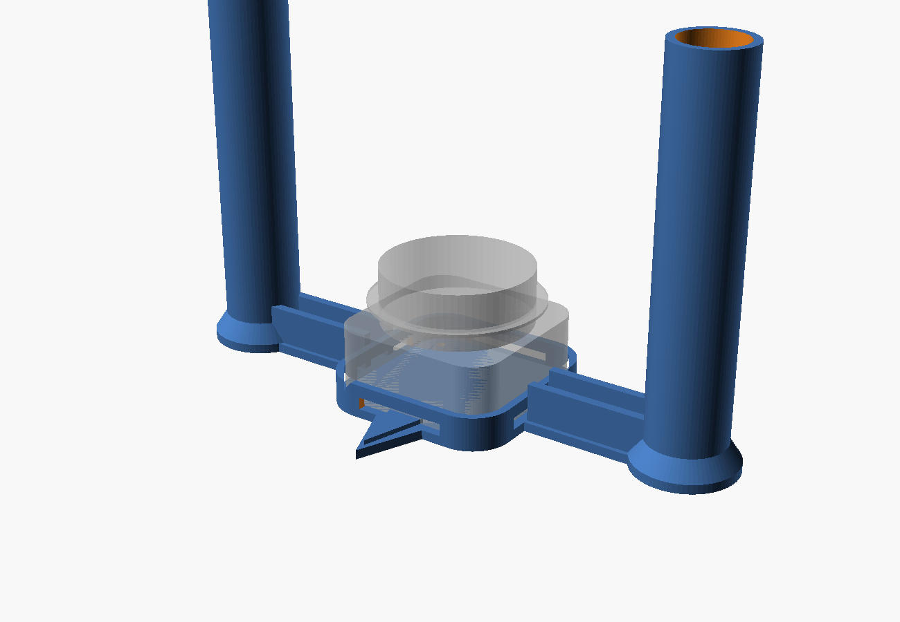
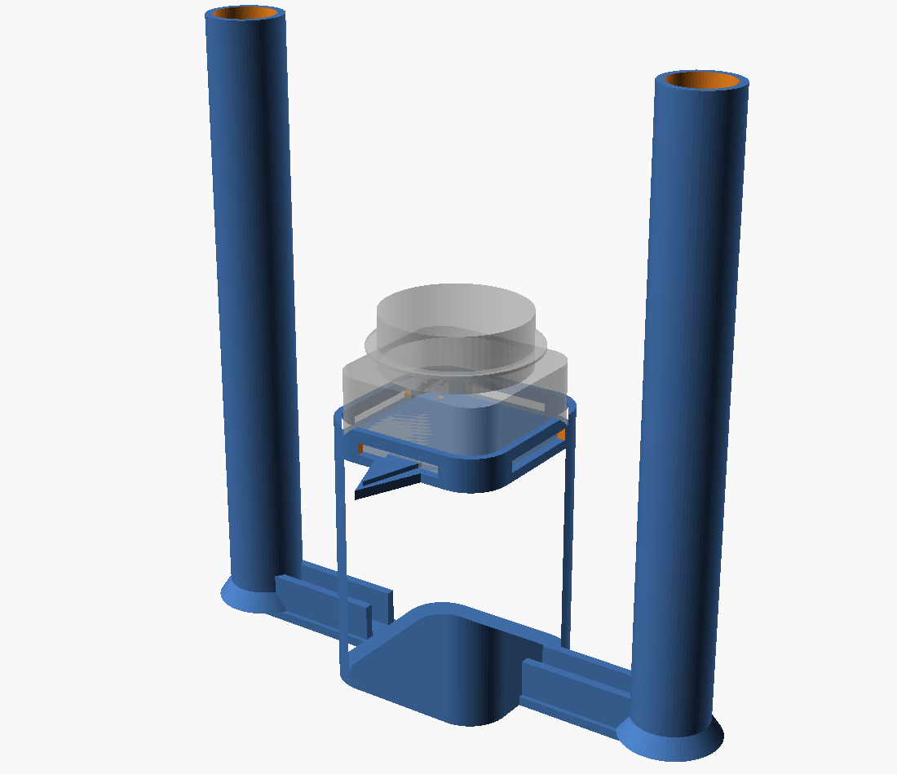

# Calibration target for the RPLIDAR C1

A jig that drops around a sensor and stands two posts either side of it, so the
other sensor has something to measure. Print two, one per sensor, use them for
the thirty seconds `calibrate_pair.py` takes, then take them off.



| | |
|---|---|
| `calibration_target.scad` | the source, parametric |
| `calibration_target.stl` | sensor on the floor. 193 x 83 x 126 mm |
| `calibration_target_raised80.stl` | same, on an 80 mm plinth. 193 x 83 x 206 mm |

Both fit a 220 mm bed. Print **two of whichever one you pick** - the pair has
to match, or the two sensors end up scanning at different heights.

## Why posts, and why two

`calibrate_pair.py` locates each sensor's **spin axis**, so the thing it
measures has to sit on that axis. Nothing can: that is where the sensor is.

Two posts can, between them. Put one each side, exactly opposite, and the
midpoint of the pair is the axis — whichever way round the jig is turned, and
from wherever you look at it. The code finds a pair of blobs 160 mm apart and
takes the middle.

A fixed spacing is also a signature. A room will happily offer up a bin or a
chair leg that looks like a lone marker; it much less often offers two things
160 mm apart that measure the same width.

## Why it is not a hat

Two numbers out of SLAMTEC's own datasheet rule that out.

**The laser is at 29.8 mm, and the case is 41.3 mm tall.** The beam leaves
11.5 mm *below* the top. Anything resting on a sensor is above the other one's
beam and simply invisible — which is why the first version of the instructions,
"stand a can on top", was wrong.

**Scan field flatness: 0 to 1.5 degrees.** The scan plane is not promised to be
level. At the limit, by the time the beam has crossed 3.4 m of carpet it has
drifted 89 mm up, so a short marker sitting at exactly 29.8 mm can be missed
completely.

Hence 120 mm posts. The top of a post ends up at 123 mm, and it wants to be at
least:

```
29.8 mm  +  separation x tan(1.5 deg)      = 119 mm across a 3.4 m diagonal
```

Only an upward tilt matters. A plane tilted *down* by 1.5 degrees hits the
floor after 1.14 m and never reaches the other sensor at all.

If your sensors sit further apart than about 3.5 m, raise `post_h` to match.

## Raising the sensor



`riser_h` puts the sensor on a hollow plinth. At 80 mm it scans at 113 mm
instead of 33 mm - lower shin rather than shoe - which keeps a walking leg in
the scan slice more of the time, so the tracker sees two legs more often
instead of one.

It cannot block the sensor, and that is checked rather than assumed: the
plinth is directly underneath, 30 mm below the beam and no wider than the case,
so at the laser plane the only things in the way are the two posts - 40 degrees
of the full circle, none of it inside the +/-72.5 degree wedge the sensor
watches.

The plinth is open underneath, so the four screws can still be reached, and
slotted down the back so the cable has a way out other than over the lip.

**The posts grow with it**, which is why the raised version is 206 mm tall and
not 126. The height is derived, not typed in:

```
post top  =  sensor base  +  29.8 mm  +  reach x tan(tilt)  +  4 mm
```

With the sensor on the floor only an upward tilt counts - a downward one hits
the carpet after about a metre and never arrives. Lift it and the downward case
starts to matter too, but the posts run to the ground anyway, so both are
covered. Change `riser_h` and the posts follow; if you want it taller than the
printer's Z height allows, drop `tilt_deg` to 1.0 and know that you are
trading the datasheet's worst case for 60 mm of print.

## Printing

Any light, matte filament — PLA or PETG is fine. **Pale is better than black:**
the C1 works at 905 nm and comes back more strongly off a light surface.

- No supports. Every overhang is a cone or a chamfer.
- 0.2 mm layers, 3 perimeters, 15% infill.
- Flat on the bed, posts upright, exactly as the STL sits.
- The posts are hollow and are most of the print. If print time matters, cut
  `post_h` — read the rule above first and know what you are giving up.

**Print two.**

## Fitting it

1. Drop the jig over the sensor. It locates on the four corner arcs, so all
   four sides stay open and the cable can leave in any direction. There is a
   gap between the twin ribs on each arm for it as well.
2. Optional: four **M2.5 x 5 mm** cap screws from underneath, into the
   sensor's own tapped holes. The counterbores keep the heads flush. It works
   without them — this is only if you want it rigid.
3. **Point the arrow at the other sensor.** That puts the posts out at
   +/-90 degrees, which is outside the 145 degree wedge the sensors actually
   watch, so they block nothing that matters. A square carpet corner is only
   90 degrees wide, so there is room to spare.

Then `python3 calibrate_pair.py`, and take both jigs off afterwards.

If you get *"sensor A can see a pair of posts; sensor B cannot"*, one jig is a
quarter turn out and its two posts are lining up one behind the other. The
message names which one to turn.

## If it does not fit

The pocket is the real C1 footprint — a 55.6 mm square with 10 mm corner radii,
arcs centred at (+/-17.8, +/-17.8) — with 0.5 mm clearance all round, taken
from SLAMTEC's STEP model rather than guessed.

Too tight is a printer calibration difference, not a design error. Raise `fit`
by 0.2 and print the centre section alone to test. Slightly loose is harmless:
the jig can only shift by whatever the slop is, and 1 mm there is nothing
against the few millimetres the calibration is aiming for.

## Changing it

Everything is parametric at the top of the `.scad`. The two that matter:

| | |
|---|---|
| `post_offset` | 80 mm. **Change this and change `JIG_SPAN_M` in `calibrate_pair.py` to match** — it is `2 x post_offset`, in metres. |
| `riser_h` | 0 mm. How far off the floor to lift the sensor. The posts grow to match. |
| `tilt_deg`, `reach_m` | 1.5 deg and 3.4 m - the worst-case scan tilt and how far apart your sensors are. These two set the post height. |

`post_offset` cannot shrink much. The posts have to stand clear of the sensor's
own case or the two merge into one blob and the pair is lost: at 80 mm there is
about 40 mm of daylight between a post and the corner of the case, against the
30 mm the clustering uses to decide what is one object.

```bash
openscad -o calibration_target.stl calibration_target.scad
openscad -o raised.stl -D riser_h=80 calibration_target.scad
openscad -o fitted.png -D show_sensor=true calibration_target.scad   # with the C1 in place
```
